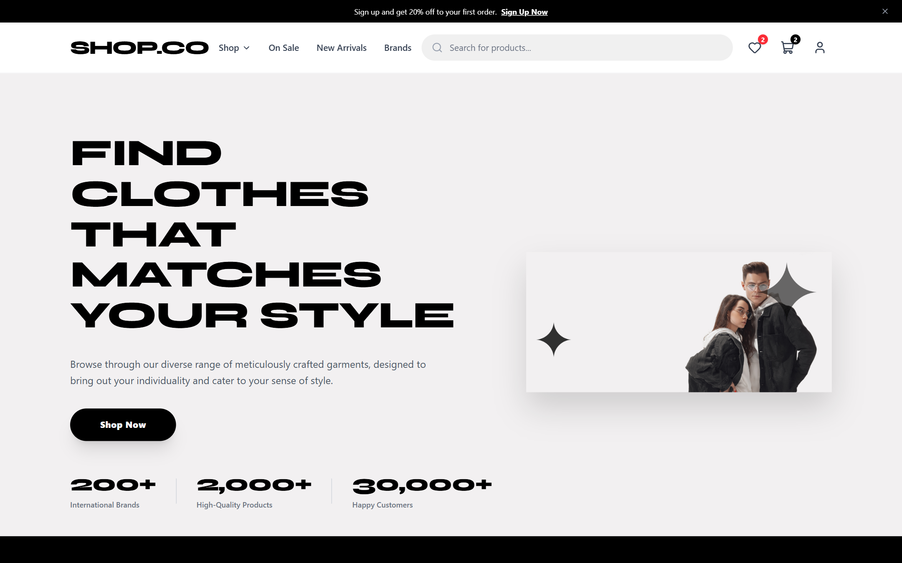
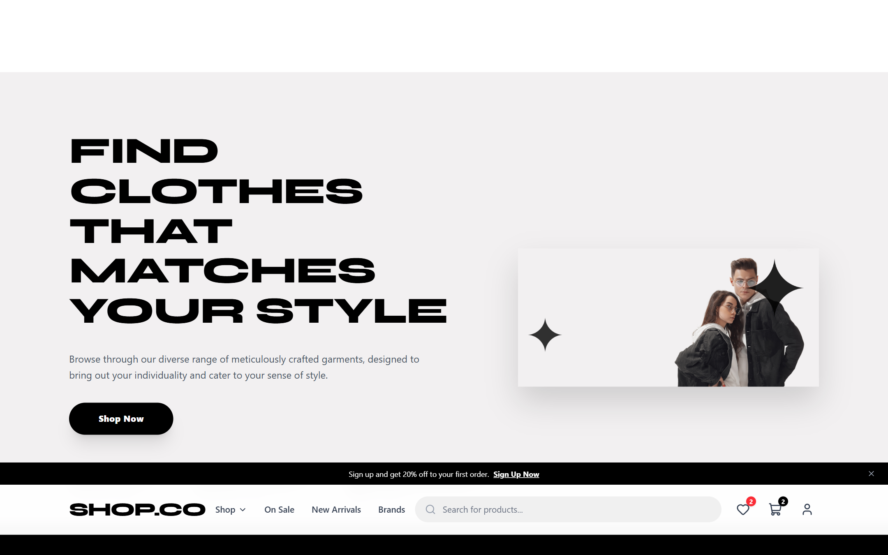
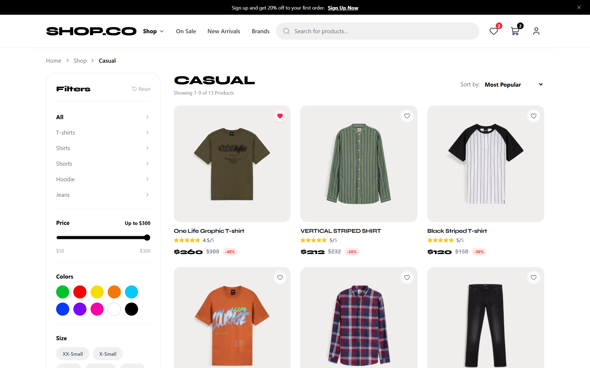
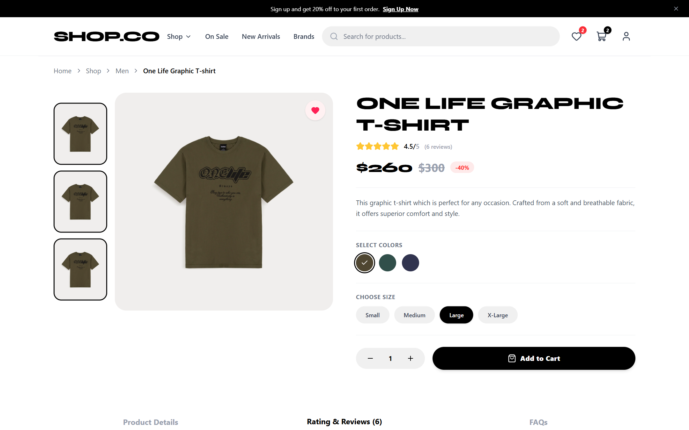
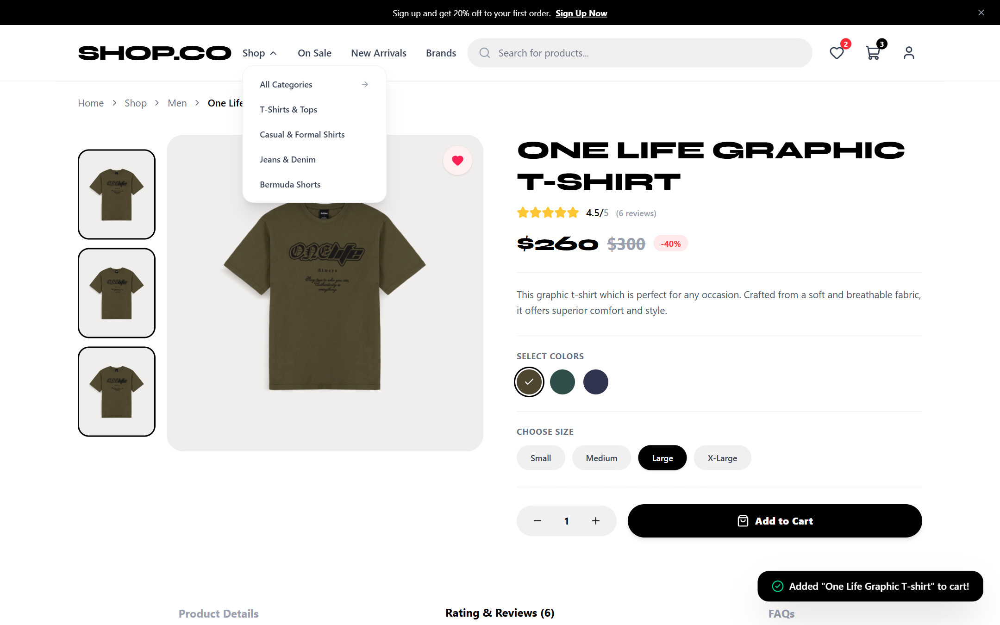
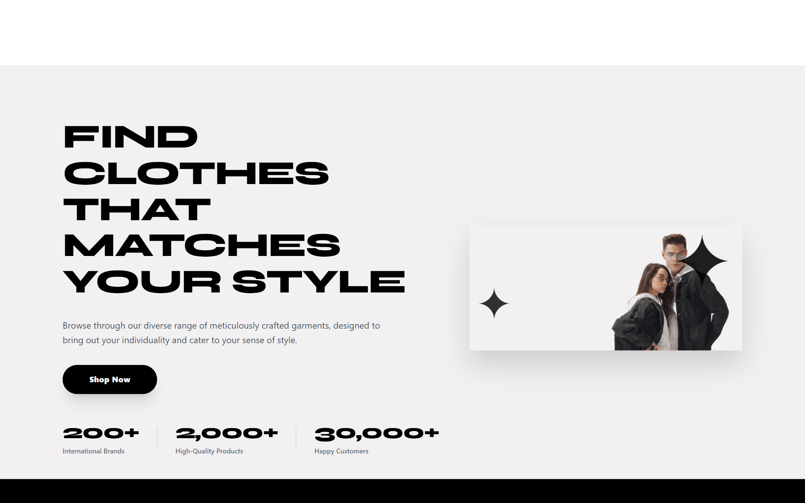

# SHOP.CO — Premium Fashion & Apparel E-Commerce Platform

A production-grade, full-stack e-commerce web application meticulously engineered from the **SHOP.CO Figma Community UI Kit** (`jKsnWGUdxa71XQle4Xk1rL`). Built with a high-performance **React 19 + Vite + Tailwind CSS v4** frontend and a robust **Python 3.13 + Django 5.2 + Django REST Framework** backend.

**Live Demo**: [https://lxlnimalxl.github.io/shopco-ecommerce-platform/](https://lxlnimalxl.github.io/shopco-ecommerce-platform/)  
**GitHub Repository**: [https://github.com/lxlnimalxl/shopco-ecommerce-platform](https://github.com/lxlnimalxl/shopco-ecommerce-platform)

---

## Visual Showcase

| 01. Homepage Hero & Brand Strip | 02. New Arrivals & Top Selling |
| :---: | :---: |
|  |  |
| **03. Browse By Dress Style** | **04. Category Catalog & Filters** |
|  |  |
| **05. Product Detail Page (PDP)** | **06. Shopping Cart & Promo System** |
|  |  |
| **07. Checkout & Invoice Receipt** | **08. Testimonials & Newsletter** |
|  |  |

---

## Architectural Highlights & Features

### 1. Interactive Homepage Experience
- **Hero Presentation**: High-contrast typography, 200+ International Brands, 2,000+ High-Quality Products, and 30,000+ Happy Customers metrics with high-res model cutouts and sparkle accents.
- **Luxury Brand Bar**: Monochromatic typographic logos for Versace, Zara, Gucci, Prada, and Calvin Klein.
- **Product Spotlights**: "New Arrivals" and "Top Selling" showcases with fractional 5-star ratings, real discount badges (`-20%`, `-30%`), and direct add-to-cart/wishlist quick actions.
- **Asymmetric Dress Style Matrix**: Clickable visual cards for *Casual*, *Formal*, *Party*, and *Gym* categories that instantly route and filter the product catalog.
- **Customer Testimonials Carousel**: Verified customer reviews with 5-star badges and directional controls.
- **Floating Newsletter Subscription**: Overlapping call-to-action banner with instant subscription validation.

### 2. Deep Catalog Filtering & Search
- **Sidebar Filter Engine**:
  - Category filters: T-shirts, Shorts, Shirts, Hoodies, Jeans.
  - Interactive price range slider ($50 to $300).
  - 10-color circular palette with selection states.
  - Dynamic size tag selector (XX-Small through 4X-Large).
  - Dress style facets with live active indicators.
- **Sorting & Pagination**: Sort by Popularity, Newest Arrivals, Price: Low to High, Price: High to Low, or Top Rated.
- **Mobile Filter Drawer**: Responsive touch-optimized off-canvas slideover for mobile viewports.

### 3. Comprehensive Product Detail Page (PDP)
- **3-Angle Gallery Selector**: Vertical interactive thumbnail preview strip syncing seamlessly with the primary zoom frame.
- **Variations & Specifications**: Color swatch selector, size selector, and interactive quantity counter.
- **Tabbed Review System**:
  - Detailed product specifications tab.
  - Customer review list with star ratings, verified badges, and posting timestamps.
  - Interactive "Write a Review" modal with star selection and live state updates.
- **Dynamic Recommendations**: "You Might Also Like" algorithmic related products row.

### 4. Cart, Discounts & Checkout Pipeline
- **Persistent Cart Engine**: Complete client-side synchronization with `localStorage` across page reloads.
- **Dynamic Promo System**: Validates discount coupons (`SHOP20`, `SUMMER30`, `WELCOME10`) with real-time subtotal and tax computations.
- **Checkout Modal**:
  - Multi-step customer address and payment method selector (Credit Card, PayPal, Apple Pay).
  - Celebratory confetti particle explosion upon successful placement via `canvas-confetti`.
  - Printable digital order receipt and invoice generator with randomized order references (`#ORD-XXXXXX`).

### 5. Wishlist Drawer
- Side-panel drawer for saved items with quick "Move to Cart" and "Remove" operations.

---

## Tech Stack

### Frontend
- **Framework**: React 19 (`react`, `react-dom`)
- **Build Tool**: Vite 8 with Rolldown compiler
- **Styling**: Tailwind CSS v4 (`@tailwindcss/vite`)
- **Icons**: Lucide React
- **Animations & Effects**: Canvas Confetti
- **Typography**: Syne (Headlines & Display), Plus Jakarta Sans (Body & UI)

### Backend
- **Framework**: Python 3.13, Django 5.2
- **API Engine**: Django REST Framework (DRF)
- **CORS**: `django-cors-headers`
- **Database**: SQLite with seeded fixtures (`Category`, `Brand`, `Product`, `ProductReview`, `Coupon`, `Testimonial`, `Order`)

---

## Project Structure

```text
n13/
├── backend/
│   ├── api/
│   │   ├── migrations/
│   │   ├── models.py
│   │   ├── serializers.py
│   │   ├── urls.py
│   │   └── views.py
│   ├── core/
│   │   ├── settings.py
│   │   ├── urls.py
│   │   └── wsgi.py
│   ├── manage.py
│   └── seed.py
├── public/
│   └── shopco-logo.svg
├── screenshots/
│   ├── 01-ecommerce-homepage-hero.png
│   ├── 02-new-arrivals-and-top-selling.png
│   ├── 03-browse-dress-style-categories.png
│   ├── 04-category-catalog-with-filters.png
│   ├── 05-product-detail-page-pdp.png
│   ├── 06-shopping-cart-order-summary.png
│   ├── 07-checkout-invoice-confirmation.png
│   └── 08-customer-reviews-and-newsletter.png
├── src/
│   ├── assets/
│   │   └── images/
│   ├── components/
│   │   ├── cart/
│   │   ├── catalog/
│   │   ├── checkout/
│   │   ├── home/
│   │   ├── layout/
│   │   ├── pdp/
│   │   └── wishlist/
│   ├── services/
│   │   └── api.js
│   ├── App.jsx
│   ├── index.css
│   └── main.jsx
├── capture_screenshots.cjs
├── index.html
├── package.json
├── README.md
└── vite.config.js
```

---

## Local Development Setup

### 1. Frontend Setup
```bash
# Clone the repository
git clone https://github.com/lxlnimalxl/shopco-ecommerce-platform.git
cd shopco-ecommerce-platform

# Install dependencies
npm install

# Start local Vite development server
npm run dev

# Build for production
npm run build
```

### 2. Backend Setup (Optional for DRF API)
```bash
cd backend

# Create virtual environment
python -m venv venv
# Windows:
venv\Scripts\activate
# Linux/macOS:
source venv/bin/activate

# Install dependencies
pip install django djangorestframework django-cors-headers

# Apply migrations & seed initial database
python manage.py migrate
python seed.py

# Start Django backend server
python manage.py runserver
```

---

## License
MIT License. Crafted by [Seyyed Nima Rounaghi](https://github.com/lxlnimalxl).
